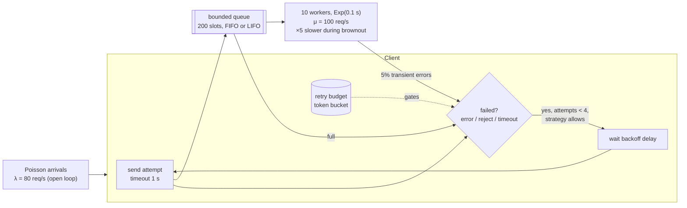
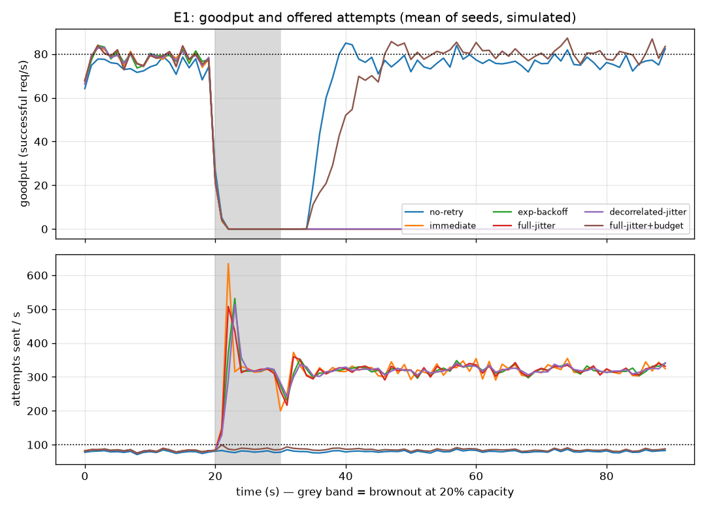
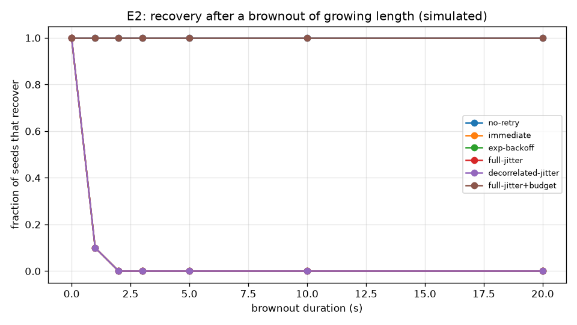
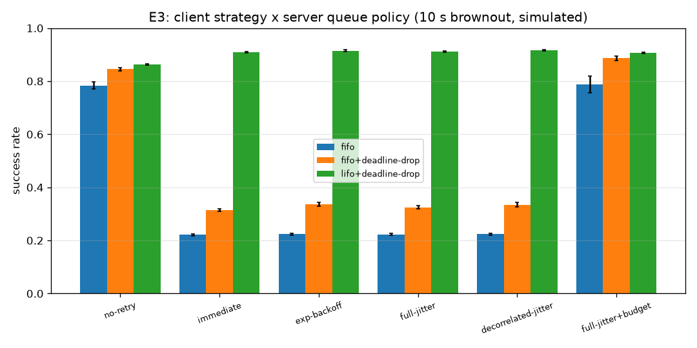
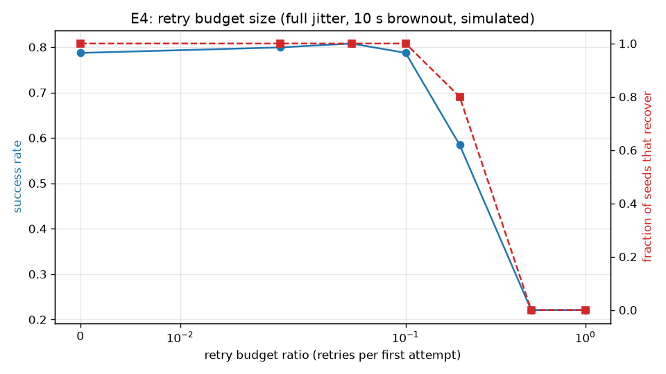

# retry-storm-lab

[](https://github.com/Subhamsharm25/retry-storm-lab/actions/workflows/ci.yml)
[](LICENSE)

**When do client retries turn a short server slowdown into an outage that never ends?** A small,
reproducible discrete-event study of six retry strategies (no retry, immediate, exponential backoff,
full jitter, decorrelated jitter, and full jitter with a retry budget) and three server queue policies,
under a 10-second brownout. One script regenerates every number and plot below, and CI re-runs it and
checks every claim in this README against the output.

## Summary

In a simulated service running at 80% load, a 10 s brownout to 20% capacity left **every unbudgeted
retry strategy stuck at zero goodput for the remaining 60 s of the run** (0 of 10 seeds recovered),
while the same service with **no retries recovered in about 6 s**. This held for brownouts as short as
2 s. Backoff and jitter did not help: immediate, exponential, full-jitter and decorrelated-jitter retries
all reached the same state (success rates within 0.2 percentage points of each other), because
each request still sends up to 4 attempts, and 4 × 80 req/s exceeds the 100 req/s capacity. A **retry
budget** (retries ≤ 10% of first attempts, token bucket) kept the retry benefit when healthy (95% → 100%
success against 5% transient errors) and recovered from every brownout. On the server side, dropping
expired requests alone did not end the storm with a FIFO queue, but **LIFO plus deadline drop** recovered
every strategy immediately, even without a budget. The budget threshold matched a one-line stability
argument: the service drains only if (1 + ratio) · λ < μ, that is, ratio < 0.25 here.

All results are from a simulator, not a real system. See [Threats to validity](#threats-to-validity).

## The problem

Retries are the standard answer to transient errors, and nearly every RPC library, SDK and service mesh
retries by default. The failure mode is well known to SRE teams but easy to rediscover the hard way:
during an overload, retries multiply the offered load, the queue fills with requests whose clients have
already timed out, the server spends its capacity on work nobody will read, and the system stays down
after the original trigger is gone. Bronson et al. named this a **metastable failure** (HotOS 2021).
Postmortems describing it come from most large cloud providers.

Common advice is "use exponential backoff with jitter". This study asks a narrower question with
numbers: *in an open-loop service with a bounded queue and client timeouts, which client and server
policies actually prevent the stuck state, and what do they cost when the system is healthy?*

## Model



| Parameter | Value | Note |
|---|---|---|
| arrivals | Poisson, 80 req/s, open loop | 80% of healthy capacity |
| server | 10 workers, exponential service, mean 0.1 s | capacity μ = 100 req/s |
| queue | 200 slots; full queue rejects at once | FIFO wait when full = 2 s > timeout |
| client timeout | 1 s per attempt | server is not told (wasted work) unless `deadline_drop` |
| attempts | at most 4 (1 + 3 retries) | |
| transient errors | 5% of completed attempts | the case retries exist for |
| brownout | t = 20 s to 30 s, service ×5 slower (20% capacity) | E2 varies the duration |
| run | 90 s of arrivals, then drain; 10 seeds per cell | common random numbers across strategies |
| backoff | base 0.1 s, cap 5 s | AWS "Exponential Backoff and Jitter" definitions |
| retry budget | +0.1 token per first attempt, retry costs 1, burst 10 | Finagle RetryBudget / gRPC retry throttling idea |

**Metrics.** *Success rate*: logical requests that eventually succeed. *Attempts / request*: load
amplification. *Wasted server work*: share of busy time spent on attempts the client had already
abandoned. *Recovered*: the first time after the brownout ends at which the 5 s mean goodput reaches
85% of the offered rate; "never" means not before the end of the run. Intervals are 95% Student-t
confidence intervals over 10 seeds. p99 latency is measured over successful requests only.

## Results

Regenerate everything with `python experiments/run_all.py` (about 30 s on 8 processes). The tables
below are copied verbatim from [`results/tables.md`](results/tables.md), and `python ci.py claims`
fails if they drift.



### E0 — healthy server, no brownout (from E2, duration 0)

| strategy | success rate | attempts / request | p99 latency (s) |
|---|---|---|---|
| no-retry | 95.0% ± 0.2 | 1.00 ± 0.00 | 0.49 ± 0.01 |
| immediate | 100.0% ± 0.0 | 1.05 ± 0.00 | 0.58 ± 0.04 |
| exp-backoff | 100.0% ± 0.0 | 1.05 ± 0.00 | 0.62 ± 0.03 |
| full-jitter | 100.0% ± 0.0 | 1.05 ± 0.00 | 0.60 ± 0.04 |
| decorrelated-jitter | 100.0% ± 0.0 | 1.05 ± 0.00 | 0.69 ± 0.03 |
| full-jitter+budget | 100.0% ± 0.0 | 1.05 ± 0.00 | 0.60 ± 0.04 |

### E1 — 10 s brownout at 20% capacity

| strategy | success rate | attempts / request | wasted server work | p99 latency (s) | recovered (median time) | goodput, last 10 s (req/s) |
|---|---|---|---|---|---|---|
| no-retry | 78.4% ± 1.4 | 1.00 ± 0.00 | 21.7% ± 1.4 | 0.81 ± 0.05 | 100% (6 s) | 76.4 ± 1.8 |
| immediate | 22.2% ± 0.4 | 3.35 ± 0.01 | 80.8% ± 0.4 | 1.28 ± 0.88 | 0% (never) | 0.0 ± 0.0 |
| exp-backoff | 22.4% ± 0.3 | 3.35 ± 0.01 | 80.8% ± 0.4 | 2.85 ± 1.15 | 0% (never) | 0.0 ± 0.0 |
| full-jitter | 22.3% ± 0.4 | 3.35 ± 0.01 | 80.8% ± 0.3 | 2.92 ± 1.04 | 0% (never) | 0.0 ± 0.0 |
| decorrelated-jitter | 22.4% ± 0.4 | 3.35 ± 0.01 | 80.8% ± 0.3 | 3.14 ± 1.23 | 0% (never) | 0.0 ± 0.0 |
| full-jitter+budget | 78.7% ± 3.1 | 1.06 ± 0.00 | 25.8% ± 3.3 | 0.94 ± 0.05 | 100% (9 s) | 80.0 ± 1.9 |

### E2 — fraction of seeds that recover, by brownout duration

| strategy | 0 s | 1 s | 2 s | 3 s | 5 s | 10 s | 20 s |
|---|---|---|---|---|---|---|---|
| no-retry | 1.0 | 1.0 | 1.0 | 1.0 | 1.0 | 1.0 | 1.0 |
| immediate | 1.0 | 0.1 | 0.0 | 0.0 | 0.0 | 0.0 | 0.0 |
| exp-backoff | 1.0 | 0.1 | 0.0 | 0.0 | 0.0 | 0.0 | 0.0 |
| full-jitter | 1.0 | 0.1 | 0.0 | 0.0 | 0.0 | 0.0 | 0.0 |
| decorrelated-jitter | 1.0 | 0.1 | 0.0 | 0.0 | 0.0 | 0.0 | 0.0 |
| full-jitter+budget | 1.0 | 1.0 | 1.0 | 1.0 | 1.0 | 1.0 | 1.0 |

### E3 — success rate by server queue policy (10 s brownout)

| strategy | fifo | fifo+deadline-drop | lifo+deadline-drop |
|---|---|---|---|
| no-retry | 78.4% ± 1.4, 100% (6 s) | 84.5% ± 0.6, 100% (0 s) | 86.3% ± 0.3, 100% (0 s) |
| immediate | 22.2% ± 0.4, 0% (never) | 31.5% ± 0.4, 0% (never) | 91.0% ± 0.3, 100% (0 s) |
| exp-backoff | 22.4% ± 0.3, 0% (never) | 33.5% ± 0.7, 0% (never) | 91.5% ± 0.3, 100% (0 s) |
| full-jitter | 22.3% ± 0.4, 0% (never) | 32.5% ± 0.5, 0% (never) | 91.3% ± 0.2, 100% (0 s) |
| decorrelated-jitter | 22.4% ± 0.4, 0% (never) | 33.4% ± 0.8, 0% (never) | 91.7% ± 0.3, 100% (0 s) |
| full-jitter+budget | 78.7% ± 3.1, 100% (9 s) | 88.6% ± 0.8, 100% (0 s) | 90.7% ± 0.2, 100% (0 s) |

### E4 — retry budget ratio (full jitter, 10 s brownout)

| ratio | success rate | attempts / request | recovered (median time) |
|---|---|---|---|
| 0.0 | 78.7% ± 1.3 | 1.00 ± 0.00 | 100% (6 s) |
| 0.02 | 79.9% ± 1.5 | 1.02 ± 0.00 | 100% (6 s) |
| 0.05 | 80.8% ± 2.0 | 1.05 ± 0.00 | 100% (8 s) |
| 0.1 | 78.7% ± 3.1 | 1.06 ± 0.00 | 100% (9 s) |
| 0.2 | 58.4% ± 14.1 | 1.12 ± 0.02 | 80% (22 s) |
| 0.5 | 22.1% ± 0.3 | 1.40 ± 0.00 | 0% (never) |
| 1.0 | 22.1% ± 0.3 | 1.78 ± 0.00 | 0% (never) |

| | |
|---|---|
|  |  |
|  | |

### What the numbers say

1. **Retries are worth it when healthy.** Against 5% transient errors, every retrying strategy lifts
   success from 95.0% to ≥ 99.99% for about 5% extra attempts (E0).
2. **Unbudgeted retries create a stable bad state.** After the brownout the queue is full, so a FIFO
   attempt waits about 200 / 100 = 2 s, longer than the 1 s timeout. Every attempt the server finishes
   has already been abandoned (81% of all server work was wasted), every request burns all 4 attempts,
   and about 320 attempts/s keep the queue full. The bottom panel of the E1 plot shows that load
   staying above capacity long after the brownout ends. A 2 s brownout was enough (E2).
3. **Backoff shape barely matters here.** With independent open-loop clients, delaying retries by
   0.1 to 0.8 s does not reduce how many are sent. Exponential, full and decorrelated jitter landed
   within 0.2 pp of immediate retry on success rate. Their higher p99 is survivorship: it covers only
   the few requests that succeeded.
4. **A budget bounds the multiplier.** With ratio r, offered attempts are at most about (1 + r) · λ.
   The queue drains only if that is below μ, so r < 100/80 − 1 = 0.25. E4 matches: r ≤ 0.1 always
   recovered, r = 0.2 (offered ≈ 96 req/s, barely below capacity) recovered in 8 of 10 seeds, and
   r ≥ 0.5 never did.
5. **Server-side shedding works only if it serves fresh work.** FIFO with deadline drop still served
   attempts at the edge of their deadline, which then timed out during service, so it raised success
   from 22% to about 33% but did not recover. LIFO plus deadline drop served the newest attempts first and
   recovered every strategy within the first 5 s window, reaching about 91% success even with
   unbudgeted retries. That is the idea behind adaptive LIFO and CoDel in production RPC servers.

## Threats to validity

* **Simulated, not measured.** No network, kernel, thread pool or GC is modelled. Service times are
  exponential and independent of load. Real servers often slow down further when overloaded (lock
  contention, GC), which would make the stuck state *easier* to enter than shown here.
* **One operating point.** Load is 80%, the queue holds 200, the timeout is 1 s and there are at most 4
  attempts. The stuck state needs a full-queue FIFO wait longer than the timeout (200/100 = 2 s > 1 s).
  With a queue of 50 it would not form this way. Results are specific to these parameters, and E2 and E4
  are the only sensitivity sweeps.
* **Open-loop clients.** Arrivals do not slow down when responses do. Closed-loop clients (a fixed
  number of users waiting for answers) self-limit and would behave differently. Jitter is designed for
  *synchronised* clients (many clients failing at the same instant), which this workload does not
  create. That is why jitter shows no effect here. This is not evidence that jitter is useless.
* **"Recovered" is a threshold metric** (5 s mean goodput ≥ 85% of offered load). A run that
  recovers in the last few seconds of the horizon counts as recovered, and "never" means "not within
  60 s after the brownout".
* **10 seeds per cell.** Rates have tight intervals, but the E4 r = 0.2 cell is bimodal (8/10 recover),
  so its mean success rate is not a good summary of a single run.
* **Floating point across platforms.** CI re-runs the study on Linux and compares it with the committed
  Windows results within tolerances (±0.02 on rates, ±2% on amplification, ±2 s on median recovery),
  not bit for bit.

## Future work

* Closed-loop and mixed workloads, and correlated client failures (where jitter should matter).
* Adaptive client policies: AIMD concurrency limits, circuit breakers, hedged requests, and how they
  interact with budgets.
* An analytic fluid or Markov model of the stuck state, to predict the recovery boundary
  (λ · E[attempts] vs μ and queue/timeout ratio) without simulation.
* Validating the boundary on a real service, for example a small HTTP server under load with
  fault injection and a k6 or Locust client.
* Load-dependent service times (service gets slower as concurrency grows), which turns the brownout
  into a self-reinforcing loop.

## Pipeline

All pipelines run the same `ci.py` stages: GitHub Actions ([`.github/workflows/ci.yml`](.github/workflows/ci.yml)),
Jenkins ([`Jenkinsfile`](Jenkinsfile), Linux or Windows agents) and a laptop.

| Stage | What it checks |
|---|---|
| `lint` | ruff lint + format check on the package, tests, experiments and `ci.py` |
| `unit` | 18 unit and property tests (hypothesis: backoff bounds, budget never exceeds burst + ratio × requests; simulator invariants, determinism, utilisation ρ = 0.8, metastability regression), coverage ≥ 90% |
| `smoke` | `run_all.py --quick` (2 seeds) produces every table, JSON and plot |
| `reproduce` | full 10-seed study from scratch, compared with the committed `results/summary.json` within tolerance |
| `claims` | every numbered claim above is asserted against the committed and the reproduced results. README tables must equal `results/tables.md` |

## Quick start

```bash
python -m venv .venv && . .venv/bin/activate        # Windows: .venv\Scripts\activate
pip install -e ".[dev]"
python ci.py all                                    # lint, unit, smoke, reproduce, claims
python experiments/run_all.py --out my-results      # regenerate everything elsewhere
```

```python
from retrylab import STRATEGIES, Scenario, simulate

r = simulate(Scenario(outage_end=25.0), STRATEGIES["full-jitter+budget"], seed=1)
print(r.success_rate, r.amplification, r.recovery_time)
```

## Layout

```
src/retrylab/policies.py   backoff schedules, token-bucket retry budget, the six strategies
src/retrylab/sim.py        event-driven simulator (heapq), metrics, recovery detection
experiments/run_all.py     E0–E4: job grid, process pool (≤ 8 workers), tables, plots
results/                   committed summary.json, tables.md and PNG plots
tests/                     unit + property tests
```

## References

* N. Bronson, A. Aghayev, A. Charapko, T. Zhu. *Metastable Failures in Distributed Systems.* HotOS 2021.
* L. Huang et al. *Metastable Failures in the Wild.* OSDI 2022.
* M. Brooker. *Exponential Backoff And Jitter.* AWS Architecture Blog, 2015.
* Twitter Finagle `RetryBudget`, and gRPC retry throttling (gRFC A6).
* K. Nichols, V. Jacobson. *Controlling Queue Delay* (CoDel). ACM Queue, 2012.

## License

MIT, see [LICENSE](LICENSE). If you use this, please cite it ([CITATION.cff](CITATION.cff)).
